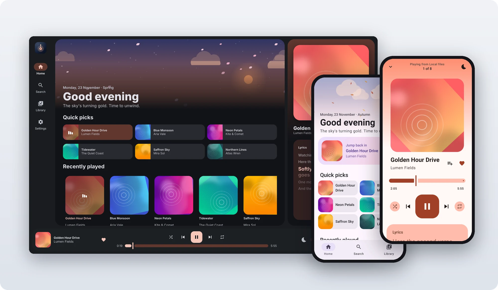

<br>

<p align="center">
  
</p>

<h1 align="center">Veena Music</h1>

<p align="center">
  A private, open-source music player for Android and Linux.
</p>

<p align="center">
  <a href="../../releases/tag/nightly"></a>
  
  <a href="LICENSE"></a>
</p>

<br>

<p align="center">
  
</p>

<br>

## Overview

Veena Music is one player for Android and Linux, built on a shared core in
Rust. Music sources are small signed plugins that update independently of
the app, so playback keeps working when a service changes.

No account. No tracking. Your library stays on your device.

## Highlights

- **Search and radio** — find music and videos; any result can start a radio of similar songs.
- **Library** — liked songs, history and playlists, ordered by drag and drop.
- **Lyrics** — synced to the song, highlighted word by word where available.
- **Offline** — songs you play in full stay available without a connection.
- **Playback** — queue, shuffle, repeat, autoplay and a sleep timer.
- **Appearance** — light and dark themes that follow the system, with colours from the artwork.

## Get started

**Android** — install `veena-arm64.apk` (Android 8.0 or later).

**Linux** — unpack `veena-music-linux-x86_64.tar.gz` or
`veena-music-linux-aarch64.tar.gz` and run `./install.sh`. No administrator
rights are needed.

Both are available on the [latest release](../../releases/tag/nightly).

## Privacy and security

Plugins run in a sandbox with access only to the domains they declare, and
none to your files. Every plugin update is signed, verified before use and
rolled back if it fails. Dependencies are checked for known vulnerabilities
on every change. To report an issue, see [SECURITY.md](SECURITY.md).

<br>

<details>
<summary><b>For developers</b></summary>

<br>

**Architecture.** A Rust core handles playback, the queue, the library and
plugin updates. The Android app (Jetpack Compose) and the Linux app (Slint)
are thin interfaces over it. Plugins, called bricks, are JavaScript files
run by an engine in the core, so the same brick works on both platforms.
Bricks fill three slots: search, audio links and lyrics. When one fails,
the next is tried. See [Writing a Veena plugin](plugins/README.md).

**Building.** Requires Rust 1.88 or newer and, on Linux, the ALSA
development files (`libasound2-dev` and `pkg-config` on Debian and Ubuntu).

```sh
cargo run --release -p veena-desktop   # Linux app
cargo build --release -p veena         # terminal player
```

For Android, `apps/android/build-rust.sh` builds the core with the Android
NDK and `cargo-ndk`; Gradle then builds the app.

**Publishing bricks.** The *Publish bricks* workflow signs changed files in
`plugins/` and publishes them to the [`bricks` release](../../releases/tag/bricks),
which both apps check daily. A brick's `version` must increase with every
code change. The signing key is the `VEENA_BRICK_KEY` repository secret.

**Layout.**

```
crates/    Rust core: core, audio, player, library, plugin, updater, net, src-local, ffi
apps/      android, desktop (Linux), linux (terminal player), sign (brick signing)
plugins/   Bricks and the brick guide
```

</details>

<br>

---

<sub>
Copyright © 2026 HarryL0L. Licensed under the <a href="LICENSE">GNU General Public License v3.0 or later</a>;
bricks you write may use any license (<a href="LICENSE-BRICKS.md">details</a>).
Veena is an independent project, not affiliated with YouTube or Google.
</sub>
